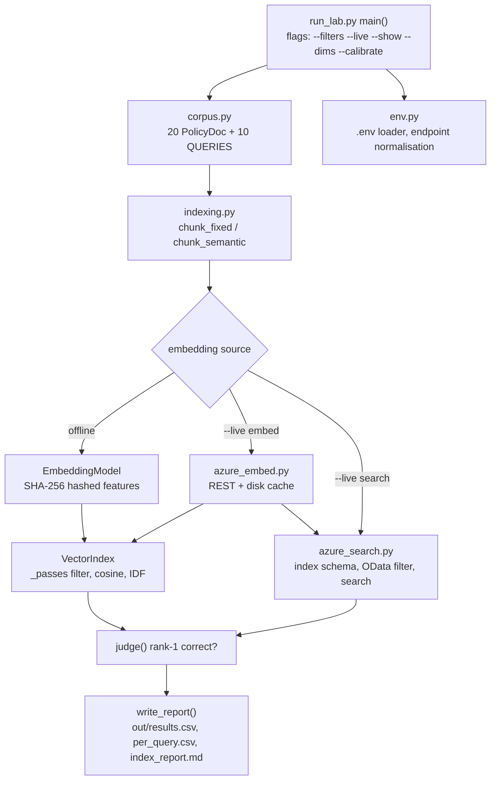

# Project Analysis — Policy Index and Metadata Filtering Lab (DecisionStream AI)

> **How to read the evidence labels in this report.** Every significant statement carries one of five labels:
> **Source-observed** (I read it in code or docs) · **Execution-verified** (an actual run artefact proves it) · **Code-derived expectation — not executed** (follows from code, nobody has run it) · **Inference** (my reasoned interpretation) · **Proposed improvement** (a recommendation, not implemented).
> I did **not** run any project code, install anything, or call Azure while writing this. The only "execution evidence" is the three files in `out/` plus a few file-system facts (sizes, timestamps, line counts), all described in §12 and §18.
> I deliberately did **not** open `.env` (it holds live secrets). I only confirmed that it exists.

---

# PART I — PROJECT AND BUSINESS UNDERSTANDING

## 3. Project identity and executive summary

| Item | Value |
|---|---|
| Project name | **Sprint 1 · Day 12 Lab — Policy Index and Metadata Filtering** (internal product name in outputs: **"DecisionStream AI — policy index lab"**) |
| Project ID | `FDE-S1D12-POLICYINDEX` — **provisional**. I found no project register in the repository, so I created this ID. Replace it if your central tracker already has one. |
| Repository path | `C:\Users\Admin\Desktop\FDEProgram\Codes\RunCompleted\Assignment2` (not a git repository) |
| Project type | Educational lab / proof-of-concept benchmark harness (Python CLI, standard library only) |
| Domain | Retrieval-Augmented Generation (RAG) retrieval layer for **insurance claims policy lookup** (synthetic data) |
| Intended users | FDE Academy learners (the README and docx say "Birlasoft FORGE FDE Academy · Confidential — For Learner Use Only"); modelled end-user is a claims handler or an automated claims-decision assistant |
| Main technologies | Python 3 (stdlib only: `argparse`, `csv`, `hashlib`, `json`, `re`, `urllib`, `dataclasses`), Azure OpenAI embeddings (REST), Azure AI Search (REST) |
| Primary capability demonstrated | Showing, with a measurable experiment, that **metadata filters (jurisdiction, product, effective date) change retrieval correctness far more than the embedding model, chunker, or retrieval mode do** |
| Implementation maturity | **Working teaching harness, not a product.** Code is coherent and heavily explained. There are no automated tests. (Source-observed) |
| Execution / test status | Offline full 54-configuration grid evidenced by `out/` files (README lever numbers reproduced). Everything else: not evidenced by me. Live Azure paths: see §12. **No automated tests exist.** |
| Most important limitation | The headline metric is partly distorted by a **judge defect**: Q08 is marked wrong even when the correct chunk is ranked first, because the expected phrase is split across a line break (§15, F01). |
| Most valuable learning opportunity | Understanding *why* filtering happens **before** similarity ranking, and how to evaluate that claim honestly (including finding the lab's own measurement bug). |

**Plain-language summary (for a recruiter or student).** A fictional insurer has 20 policy documents. Several contain *the same clause with different answers* (older versions, other countries, other products). The lab cuts the documents into chunks, turns chunks into number-vectors (embeddings), and builds a searchable index. It then asks 10 questions and measures how often the *correct* chunk ranks first, under every combination of chunker × embedding model × filter setting × search method (54 combinations). The central finding claimed by the authors is: adding the right metadata filters improves results by roughly six questions out of ten, while every other choice moves results by less than one. The lab can run fully offline with simulated embeddings, or live against Azure OpenAI and Azure AI Search.

---

## 4. Business problem and value

**Status of this section.** The scenario is a **course exercise on synthetic data** (Source-observed: `corpus.py` header; README). No real customer, deployment, or business outcome is documented, and none is claimed here.

**The modelled situation.** An insurer's policy library accumulates versions: the UK Motor wording exists for 2024, 2025 and 2026; Ireland and the EU have their own; Property has its own. Nobody deletes old wording because "a claim decided in 2024 may still need to be explained using the rules valid at that time" (Source-observed: README).

**Workflow involved.** A claim is decided → the handler (or an AI assistant) asks a policy question ("What is the total loss threshold?") → the system retrieves the relevant clause → a decision is made and recorded. The corpus itself describes this workflow: `PRC-CLM-UK-2026` (intake → assessment → engineer referral → settlement), and `POL-CON-UK-2026` §4 says no decision significantly affecting a customer is made solely by automated means (Source-observed: `corpus.py`).

**Stakeholders (Inference, from corpus content).** Claims handlers; customers affected by the decision; compliance/conduct teams; engineering teams building the retrieval layer.

**The problem.** Six documents give six different answers to "total loss threshold" (70, 65, 60, 55, 65 and 80 per cent). All are well-written and semantically near-identical. A similarity search alone returns whichever is closest to the query wording, which may be the wrong country, year, or product.

**Consequence if unresolved (Inference).** A confidently worded but wrong answer — e.g. applying the 2026 threshold to a claim decided in June 2025 (the lab's Q06) — could produce an incorrect or unexplainable decision. The lab's own conduct policy text highlights that decisions must be explainable.

**How the implementation addresses it.** It stores `jurisdiction`, `policy_type`, `effective_from`, `effective_to` with every chunk and applies them as a filter **before** ranking, then measures the effect.

**Potential value (not realised value).** Reduced risk of retrieving the wrong policy version; an evidence-based argument for spending engineering time on metadata design rather than model tuning. **No savings, adoption, or revenue figure exists in the repository and none should be inferred.**

**Limitations of the proposed solution.**
- 20 documents / 45 chunks is a teaching corpus; results may not transfer to thousands of documents.
- It measures only "is the correct chunk at rank 1" — not answer quality, latency, or recall beyond rank 1 (the report says so itself).
- The metadata (dates, jurisdictions) is hand-assigned and perfect; in real life, extracting that metadata from PDFs is itself a hard problem the lab does not attempt.

**How value could be measured in a real setting (Proposed improvement).** Rate of wrong-version answers on a labelled query set; handler time per lookup; percentage of answers with correct version citation; number of escalations caused by retrieval errors.

---

## 5. Technical and educational problem

**Technical challenge.** Retrieve the *applicable* policy chunk when many near-duplicate chunks exist, and evaluate retrieval methods fairly.

**Why a naive implementation fails.** Embedding similarity measures "how similar is this text to the query", not "is this text in force, for this country, on this date". Two clauses that differ only in a number are almost equally similar to any question.

**Engineering concepts explored.**

| Concept | Status in the repository |
|---|---|
| Chunking (fixed vs structure-aware) | **Implemented** (`indexing.py`) |
| Embeddings, simulated and real | **Implemented** (simulated: `indexing.py`; real: `azure_embed.py`) |
| Dimension truncation (Matryoshka) | **Implemented** (client-side truncate + renormalise in `azure_embed.py`; offline version re-hashes, not truncates — see §9) |
| Metadata pre-filtering | **Implemented** (offline `_passes`; live OData `$filter`) |
| Keyword (BM25-like), vector, hybrid retrieval | **Implemented** (offline: own IDF/cosine/50-50 blend; live: Azure BM25/HNSW/RRF) |
| `vectorFilterMode` pre/post/strictPost | **Implemented** against live Azure; `postFilter` honestly reported as unmeasurable at this scale |
| Score-scale calibration for "not found" decisions | **Implemented** (`--calibrate`, per-mode thresholds) — with a configuration bug (F02) |
| Temporal validity with open-ended `effective_to = null` | **Implemented** (OData null-safe clause) |
| Production ingestion validation of required metadata | **Documented only** (a question in the report, no code) |
| End-to-end RAG answer generation | **Not present** (retrieval only) |

**Learning objectives (measurable).**

| ID | Objective | How to demonstrate it |
|---|---|---|
| LO1 | Explain why filter-before-rank beats rank-then-filter | Run `--live search` strictPostFilter case, or write a 10-line offline post-filter and show it loses queries |
| LO2 | Trace one query end-to-end through chunking → index → filter → score → judge | Annotate Q06 using `--show Q06` plus code reading |
| LO3 | Interpret a lever-swing table | State which lever matters and why swing, not winner, is the right read |
| LO4 | Explain why one relevance threshold cannot serve BM25, cosine and RRF | Run `--calibrate`, compare scales, explain in your own words |
| LO5 | Find and fix a defect in an evaluation harness | Reproduce F01 and F02, fix, add tests |
| LO6 | Explain null-handling in date-range filters | Write the right and wrong OData clause and predict outputs |
| LO7 | Explain what an index schema decision costs to change | Describe why `filterable` forces a drop + re-embed |

---

## 6. Solution overview and end-to-end workflow

**Inputs.** (1) 20 hard-coded `PolicyDoc` objects and 10 query dicts in `corpus.py`. (2) CLI flags. (3) For live mode, `.env` / environment variables (endpoint, keys, deployments).

**Processing stages.** Chunk → embed → build index → for each query apply filter → score → rank → judge → aggregate → write report.

**Transformations/decisions.** Filter dict → predicate (offline) or OData string (live); per-mode negative-query cutoff; strict rank-1 correctness test.

**AI/model operations.** Offline: deterministic hashed bag-of-words "embeddings" (not a trained model). Live: Azure OpenAI `text-embedding-3-small/large` via REST.

**External integrations.** Azure OpenAI embeddings endpoint; Azure AI Search REST API (`/indexes`, `/docs/index`, `/docs/search`, `/servicestats`).

**Persistence.** `.cache/*.jsonl` (embedding cache), `out/*.csv` and `out/index_report.md`, and the Azure index itself in live-search mode.

**Outputs / side effects.** Console tables, three files in `out/`; in live mode, creates/deletes an Azure Search index and spends a small amount of embedding money.

**Error paths.** `ConfigError` → exit 2; `AzureEmbedError`/`SearchError` → exit 3 with a hint to run `--probe`; other exceptions re-raised. **Human intervention:** none in the code path; the human reads the reports.

**Numbered workflow (offline default, Source-observed; not executed by me):**

1. `python run_lab.py` → `main()` calls `envlib.load_dotenv()` (`run_lab.py:901`).
2. `argparse` parses flags (`run_lab.py:903-924`); banner printed with document/query counts.
3. With no `--live`, `models=None`, `backend="offline"`.
4. `itertools.product(CHUNKERS, ("small","large"), fmodes, modes)` creates **3 × 2 × 3 × 3 = 54** configurations (`run_lab.py:1013`).
5. For each, `run_config()` → `build_index()` → `chunk_docs()` → `VectorIndex.__init__` embeds every chunk and builds IDF.
6. For each of 10 queries: `FILTER_MODES[fmode](q)` builds the filter dict; `idx.search()` filters, scores, sorts, truncates to `top_k=3`.
7. `judge()` marks the query correct or not.
8. Results aggregated; `write_report()` writes `results.csv`, `per_query.csv`, `index_report.md`; `print_levers()` prints swings.



---

# PART II — ARCHITECTURE AND CODE

## 7. Architecture and component responsibilities

The architecture is a **single-process CLI with a swappable back end**. The design goal (stated in `azure_embed.py` and `azure_search.py`) is that you change exactly one thing at a time — embeddings, then the whole index — while chunking, filters, judge and report stay identical. The "duck typing" contract is: anything with `.embed(text, dims)`, `.dims`, `.price_per_1m_tokens` can act as an embedding model; anything with `.search(query, top_k, flt, mode)` returning `[(Chunk, score)]` and `.candidate_count(flt)` can act as an index. (Source-observed)

### Component table

| ID | Component | File | Responsibility | Key entry points | Error handling | Limitations |
|---|---|---|---|---|---|---|
| C01 | CLI orchestrator | `run_lab.py` | Parse flags, route to offline / live-embed / live-search flows, print tables | `main()` (line 900) | Catches `ConfigError` (exit 2), Azure errors (exit 3) | One 1,100-line file mixing CLI, scoring config, report generation |
| C02 | Judge and thresholds | `run_lab.py` | Decide if a result list is correct; per-backend-per-mode negative cutoffs | `judge()` (128), `NEGATIVE_THRESHOLD` (95) | None needed | F01 (newline), F02 (import-time env read), negative queries pass on empty results |
| C03 | Experiment runners | `run_lab.py` | `run_config`, `show`, `calibrate_index`, `dims_experiment`, `run_search_grid`, `show_search`, `calibrate`, `provision` | see names | Inherits | Rebuilds the index for every config (fine at this size) |
| C04 | Report writer | `run_lab.py` | Markdown glossary + tables + CSVs; paired pre/post filter comparison | `write_report` (496), `glossary` (343), `paired_filter_mode` (627), `print_levers` (656) | None | No encoding specified on write (F03); "best config" arbitrary on ties (F13) |
| C05 | Corpus and queries | `index_lab/corpus.py` | 20 policy docs with metadata; 10 queries with expected answers and "traps" | `DOCS`, `QUERIES`, `PolicyDoc` | n/a | Hand-made; `in_force()` is unused (F05) |
| C06 | Chunkers | `index_lab/indexing.py` | `chunk_fixed` (256/512 tokens, overlap) and `chunk_semantic` (clause/section headings) | `CHUNKERS`, `chunk_docs` | n/a | Token count approximated as chars/4 |
| C07 | Simulated embeddings | `index_lab/indexing.py` | Hash words (+bigrams, +synonyms) into signed fixed-length vectors, L2-normalised | `EmbeddingModel.embed`, `MODELS` | n/a | Not a learned model; offline "truncation" re-hashes |
| C08 | Local vector index | `index_lab/indexing.py` | Hold chunk vectors + token sets + IDF; filter, score, rank | `VectorIndex.search`, `_passes`, `candidate_count` | n/a | Linear scan; hybrid is an arbitrary 50/50 blend |
| C09 | Config loader | `index_lab/env.py` | `.env` parsing (shell wins), typed getters, endpoint normalisation | `load_dotenv`, `get`, `normalise_*` | `ConfigError` names the missing variable | Does not handle quotes with `#` comments inside values |
| C10 | Azure embeddings client | `index_lab/azure_embed.py` | REST embeddings, two routes (v1 / classic), batching, retry/backoff, disk cache, truncation, probe | `AzureEmbeddingModel`, `probe`, `build_models` | HTTP error wrapping; retry on 429/500/503 | Retry detection by string matching; no `Retry-After` honour; timeouts not wrapped |
| C11 | Azure Search client | `index_lab/azure_search.py` | Index schema, OData filter builder, create/drop/upload/search/count/stats | `index_schema`, `odata_filter`, `AzureSearchIndex` | `SearchError` with HTTP detail | Extra HTTP call per `candidate_count`; preview API version may age |
| C12 | Configuration files | `.env.example`, `.env`, `.gitignore` | Settings template; secrets; ignore rules | n/a | n/a | `.env` exists with secrets; folder is not a git repo so `.gitignore` is currently inert |
| C13 | Run artefacts | `out/*`, `.cache/*` | Generated reports; cached vectors | n/a | n/a | `out/` is overwritten each run |
| C14 | Documentation | `README.md`, `How_to_Read_the_Results.docx` | Lab instructions and reading guide | n/a | n/a | Contains numeric claims I could not verify; Q08 explanation conflicts with evidence (F16) |

### Component interaction table

| From | To | What passes | Contract |
|---|---|---|---|
| C01 | C05 | `DOCS`, `QUERIES` | module import |
| C01 | C06→C08 | `build_index(DOCS, chunker, model, dims, models)` | returns `VectorIndex` |
| C08 | C07 or C10 | `embed(text, dims)` / `embed_all(texts, dims, progress)` | `embed_all` used if present |
| C01 | C02 | `(hits, query, backend, mode)` | returns `(bool, reason)` |
| C03 | C11 | `idx.search(q, k, flt, mode, vector_filter_mode)` | returns `[(Chunk, score)]` rebuilt by `_to_chunk` |
| C11 | C10 | `embedder.embed_all` (upload), `embedder.embed` (query) | same duck type |
| C03 | C04 | list of result dicts | keys: chunker, model, filters, retrieval, correct, rows, … |
| C01 | C09 | `load_dotenv`, getters | env vars |

**Why the structure matters.** The one-to-one mapping documented in `azure_search.py` lines 7-13 (`_passes()` ↔ OData `$filter`, `mode="keyword"` ↔ BM25, etc.) is the teaching device: the learner builds the mechanism by hand first, then sees the managed service do the same job. No artificial layers were added.

---

## 8. Technology stack and roles

| Technology | Role in this project | Where used | Why used | Alternatives and trade-offs |
|---|---|---|---|---|
| Python 3 standard library | Everything, including HTTP | all `.py` | Runs on locked-down VMs with no `pip install` (stated rationale, `env.py` header) | Official SDKs (`openai`, `azure-search-documents`) give retries, typing and auth options at the cost of install friction (analysis) |
| `urllib.request` | REST calls to Azure | `azure_embed._post`, `azure_search._call` | Shows every HTTP call explicitly | `requests`/`httpx` are friendlier; SDKs handle versions (analysis) |
| `hashlib.sha256` | Feature hashing for simulated vectors; cache keys | `indexing.py`, `azure_embed.py` | Deterministic, no dependency | n/a |
| `dataclasses` | `PolicyDoc`, `Chunk`, `EmbeddingModel` | `corpus.py`, `indexing.py` | Light structured records | `pydantic` adds validation (analysis) |
| `argparse`, `csv`, `itertools`, `pathlib` | CLI, reports, grid, paths | `run_lab.py` | Stdlib | — |
| Azure OpenAI `text-embedding-3-small/large` | Real embeddings in live modes | `azure_embed.py` | Realistic vectors; Matryoshka truncation support | Open-source embedding models run locally with no per-token cost but need installation (analysis) |
| Azure AI Search (REST, api-version `2026-04-01` per source) | Real filterable index, BM25, HNSW, RRF | `azure_search.py` | Shows managed-service behaviour | Elasticsearch/OpenSearch, pgvector, Pinecone etc. (analysis) |
| HNSW (cosine) | Approximate nearest-neighbour index | `index_schema` | Azure's vector index | Flat/exhaustive KNN (used here via `exhaustive: True`) |
| OData `$filter` | Metadata filter language | `odata_filter` | Azure's filter syntax | n/a |
| Matryoshka truncation | Cheaper smaller vectors | `azure_embed._truncate` | Cost lever | Server-side `dimensions` parameter |

No dependency manifest exists (no `requirements.txt`), which matches the README's intent. Third-party imports: none (Source-observed across all six `.py` files).

---

## 9. Detailed code walkthrough

### Step 1 — Startup and configuration (`run_lab.py:36-44, 900-929`)
- **Trigger:** `python run_lab.py [flags]`.
- At import time: `sys.path.insert(0, index_lab)`, imports `corpus`, `indexing`, `env`, creates `out/` (side effect on import), and **builds the `NEGATIVE_THRESHOLD` dictionary** by calling `envlib.get_float(...)` for the `DS_NEG_*` settings.
- Then `main()` calls `envlib.load_dotenv()`.
- **Why it matters / defect:** the thresholds are read *before* `.env` is loaded, so values placed in `.env` are ignored; only variables already exported in the shell take effect (F02). (Source-observed. Behavioural consequence is Code-derived expectation — not executed.)

`load_dotenv` (`env.py:30-46`) reads `.env` line by line, skips comments, strips quotes, and **sets `os.environ[key]` only if not already set** ("the shell wins"). `get()` treats empty values and values beginning with `<` (e.g. the `<your-key>` template placeholder) as unset, and raises `ConfigError` naming the variable when `required=True`.

### Step 2 — Corpus and queries (`corpus.py`)
- `PolicyDoc` holds `id, title, policy_type, jurisdiction, effective_from, effective_to, version, superseded, text`. `.meta()` returns everything except `text` — this dict travels with every chunk.
- 10 hand-written documents plus 10 "filler" documents = **20**. Dates are ISO strings so string comparison equals date comparison.
- Each query carries a **decision context** (`jurisdiction`, `decision_date`, `policy_type`) because "the correct answer depends on it", plus `expect_doc`, `expect_text`, and a `trap` explanation.
- Note: the `policy_type` comment says `motor | property | liability | conduct` but the data also uses `process`, `fraud`, `data`, `reinsurance` (stale comment, Source-observed).

### Step 3 — Chunking (`indexing.py:94-133`)

```python
def chunk_fixed(doc, target_tokens):
    chars = target_tokens * 4          # 1 token ≈ 4 characters
    overlap = chars // 8
    ...
        i += max(1, chars - overlap)   # slide the window forward
```
- Fixed: 256 tokens → 1,024 characters, step 896; 512 tokens → 2,048 characters, step 1,792. Cuts wherever the window ends.
- Semantic: `HEAD_RE` matches `CLAUSE 4.1 …` / `SECTION 2 …` lines; if at least two headings exist, text is cut at each heading so a heading travels with its body. Otherwise it falls back to blank-line splitting.
- **Execution-verified counts** (from `out/index_report.md` and `results.csv`): `fixed_256` = 21 chunks, `fixed_512` = 20, `semantic` = 45. I independently reproduced 45 by hand-counting headings (32 in the ten hand-written documents + 13 in filler). This means almost every document fits in one fixed chunk, so the two fixed chunkers are nearly the same experiment.

### Step 4 — Simulated embeddings (`indexing.py:139-170`)
- `features()`: tokens (stop-words removed); `large` adds bigrams (`a_b`) and synonym expansions from the small `SYNONYMS` table.
- `embed()`: for each feature, SHA-256 → first 16 hex digits → integer `h`; bucket `h % d`; sign from bit 63; accumulate; L2-normalise.
- Result: unrelated texts are nearly orthogonal (cosine ≈ 0), unlike real embeddings (the code comments say real ones have a floor of about 0.15 — Source-observed claim from the authors' measurement).
- **Offline `--dims`** calls `embed(text, d)` which *rehashes into d buckets*; this differs from real Matryoshka truncation (keep first d values). It shows collision damage, not Matryoshka behaviour (Source-observed; important caveat for interpretation).

### Step 5 — Building the local index (`VectorIndex.__init__`, `indexing.py:191-213`)
- Embeds every chunk (uses `embed_all` if the model provides it — real Azure does; simulated does not).
- Builds `toks` (set of tokens per chunk) and `idf = log(1 + N/(1+df))`.
- `embed_tokens = sum(chunk.n_tokens)` — an *approximate* token count (chars/4), used for the cost columns.

### Step 6 — Filter and search (`VectorIndex._passes`, `search`, `indexing.py:215-253`)
- `_passes`: jurisdiction equality, policy_type equality, and "in force on date": `effective_from <= on` and (`effective_to` is empty or `effective_to >= on`). End date is **inclusive**.
- `search`: embeds the query once; **skips chunks that fail the filter before scoring** (this is the pre-filter); scores by mode:
  - `vector` = cosine;
  - `keyword` = sum of IDF over query∩chunk tokens;
  - `hybrid` = `0.5*cosine + 0.5*(keyword/10)`. The `/10` is an arbitrary scaling constant (not RRF).
- Sorts descending, returns top_k. `candidate_count` counts chunks passing the filter.

### Step 7 — The judge (`run_lab.py:128-145`)
Rules (Source-observed):
1. Negative query (`expect_doc is None`): correct if there are no hits, or the top score is below the cutoff for `(backend, mode)`.
2. Otherwise: no hits → wrong; top document id must equal `expect_doc`; and `expect_text.lower()` must be a **substring of the top chunk text**.

Two consequences:
- The substring test is whitespace-sensitive (F01).
- A filter that returns **zero hits** makes the negative query Q10 "correct" (`"no candidates"`), so a broken filter can look good on Q10.

### Step 8 — Experiment grid and report (`run_config`, `write_report`, `paired_filter_mode`, `print_levers`)
- `run_config` returns a result dict containing per-query rows.
- `write_report` writes the CSVs and Markdown. Lever averages use only `preFilter` rows (so adding the postFilter experiment cannot move the other numbers). `best` = highest `correct`, tie-broken by lowest cost.
- `paired_filter_mode` compares pre vs post modes **only where both ran**, deliberately avoiding an unbalanced average.
- **Defect:** files are written without `encoding=`; on Windows this defaults to the legacy code page (F03).

### Step 9 — `--show`, `--calibrate`, `--dims` (offline and live-embed)
- `show(qid)`: for `small`/`large` × each filter mode, builds a semantic index and prints top 3 with a `cands=` count.
- `calibrate_index`: positive query = `QUERIES[0]` (Q01), negative = `QUERIES[-1]` (Q10); prints real-top, absent-top, corpus floor and a suggested cut (midpoint if separated). It tells you to copy values into `.env` — which per F02 will be ignored unless exported in the shell.
- `dims_experiment`: ladder 3072…32 limited to ≤ native dims; runs `vector` mode with `full` and `none` filters.

### Step 10 — Live embeddings (`azure_embed.py`)
- `resolve_aoai()` requires `AZURE_OPENAI_ENDPOINT` and `AZURE_OPENAI_API_KEY`; `api_version` unset ⇒ **v1 route** (`/openai/v1/embeddings`, deployment name in body `model`), set ⇒ **classic route** (`/openai/deployments/<dep>/embeddings?api-version=…`).
- `build_models()` creates `small` and `large` models from `AZURE_EMBED_DEPLOYMENT_*`, `*_DIMS_*`, `*_PRICE_*`.
- `embed_many()`: deduplicates texts, looks up a SHA-256 key in memory/disk cache, sends only missing texts in batches of 64, appends each new vector to `.cache/<hash>.jsonl`.
- `_request_with_retry`: up to 4 attempts, doubling delay from 2 s, for messages containing `HTTP 429/503/500`.
- `_truncate`: keeps first `d` components and **renormalises** (the comment explains that skipping renormalisation yields plausible-looking but wrong rankings).
- `probe()`: tries both routes with the text "ping" and reports pass/fail and latency.
- Cache scope: keyed by endpoint + deployment + native dims, so truncation reuses the same cache.

### Step 11 — Live Azure Search (`azure_search.py`)
- `index_schema()` marks `policy_type`, `jurisdiction`, `effective_from`, `effective_to`, `superseded`, `version`, `doc_id` filterable; `content` searchable with analyzer `en.microsoft`; vector field `contentVector` (`Collection(Edm.Single)`), `retrievable: False`, `stored: False`, HNSW with `metric: cosine`.
- `sanitise_key()` replaces any character outside `[A-Za-z0-9_\-=]` with `_` (e.g. `POL-MOT-UK-2026#s-0` → `POL-MOT-UK-2026_s-0`); original saved in `chunk_id`.
- `odata_filter()` produces e.g.

  `jurisdiction eq 'UK' and policy_type eq 'motor' and effective_from le 2026-04-01T00:00:00Z and (effective_to eq null or effective_to ge 2026-04-01T00:00:00Z)` *(illustrative; built from the code, not observed output)*.

  The parenthesised `eq null` branch is essential: a null `effective_to` never satisfies a comparison, so omitting it silently removes every currently-valid policy.
- `create(recreate=True)` **drops an existing index of the same name**, sleeps 2 s, then PUTs the schema.
- `upload()` embeds all chunks, converts each to a document, posts in batches of 100, and raises if any item reports failure.
- `wait_until_indexed()` polls `/docs/$count` every 2 s up to 90 s, because indexing is asynchronous.
- `search()` builds the JSON body: `search`+`searchFields` for keyword/hybrid; `vectorQueries` with `exhaustive: True` for vector/hybrid; `vectorFilterMode` as chosen; uses the preview api-version only for `strictPostFilter`.
- `run_search_grid` skips non-pre modes when retrieval is keyword or filters are `none` (they are meaningless there). Counting: 3 filter modes × 3 retrieval × 3 vector-filter-modes minus skipped = **17 configurations** (Code-derived expectation — not executed).

### Step 12 — Failure and handling summary

| Failure | Where | Handling |
|---|---|---|
| Missing env variable | `env.get(required=True)` | `ConfigError` → message + exit 2 |
| HTTP error from Azure | `_post`, `_call` | wrapped in `AzureEmbedError` / `SearchError`, exit 3, suggests `--probe` |
| 429/500/503 | `_request_with_retry` | exponential backoff, 4 attempts |
| Network unreachable | `URLError` branch | wrapped; no retry |
| Socket read timeout | not wrapped | may surface as a raw exception (Code-derived expectation — not executed) |
| Index missing | `exists()` | prints how to `--provision`, exit 1 |
| Documents not searchable yet | `wait_until_indexed` | polls then warns |

---

## 10. Inputs, outputs, and data contracts

**`PolicyDoc` fields.** `id` (string), `title`, `policy_type`, `jurisdiction` (`UK|IE|EU`), `effective_from` (ISO date), `effective_to` (ISO date or `None`), `version`, `superseded` (bool), `text`. There is **no validation**: nothing rejects a document with a missing date or unknown jurisdiction (F-gap noted in §15).

**`Chunk`.** `id` like `POL-MOT-UK-2026#s-0` (semantic) or `#f256-0`/`#f512-0` (fixed), `doc_id`, `text`, `n_tokens` (chars/4), `meta` (the doc metadata dict).

**Query dict.** `id, type, q, jurisdiction, decision_date, policy_type, expect_doc, expect_text, trap`.

**Filter dict (internal contract).** `{"jurisdiction": …, "policy_type": …, "in_force_on": "YYYY-MM-DD"}`; `None` means no filter. Note `FILTER_MODES["full"]` passes `q.get("policy_type")`, and `_passes` ignores falsy values.

**Azure index document.** Fields listed in Step 11. Dates become `YYYY-MM-DDT00:00:00Z`; `effective_to` null stays null.

**Cache record.** One JSON line `{"k": sha256(text), "v": [floats]}`. (Source-observed. Existing cache files: two, each 67 lines, 2.1 MB and 4.3 MB — consistent with 1,536-dim and 3,072-dim vectors; Inference.)

**Outputs.**

| File | Content | Evidence |
|---|---|---|
| `out/results.csv` | `chunker, model, filters, retrieval, dims, chunks, correct, of, avg_candidates, embed_tokens, embed_cost` (+ `filter_mode` in live search) | Execution-verified: 18 data rows, all `filters=full`, all `correct=9` |
| `out/per_query.csv` | one row per config × query with `top_doc`, `why`, `candidates` | Execution-verified: 180 rows |
| `out/index_report.md` | glossary, all configs, lever swings, best configuration, six ADR questions | Execution-verified, with encoding artefacts (F03) |

**Representative observed example** (from `per_query.csv`):
`semantic,large,full,vector,Q08,paraphrase,False,POL-CON-UK-2026,"right doc, wrong chunk (POL-CON-UK-2026#s-2)",3` — the top document is correct, the chunk `#s-2` is the "SECTION 4 AUTOMATED DECISIONS" clause, yet the judge says wrong. This is the evidence behind F01.

---

## 11. Setup and execution guide

*None of the commands below has been run by me. They are Code-derived expectations.*

**Prerequisites.** Python 3.7+ per the README (your `__pycache__` folders show `cpython-313`, so you ran Python 3.13 — Execution-verified by file names). No packages. Live modes need an Azure OpenAI resource with two embedding deployments and an Azure AI Search service (admin key).

**Windows PowerShell (your platform):**
```powershell
cd C:\Users\Admin\Desktop\FDEProgram\Codes\RunCompleted\Assignment2
python -m venv .venv          # optional; the lab itself needs no packages
.\.venv\Scripts\Activate.ps1  # if blocked: Set-ExecutionPolicy -Scope CurrentUser RemoteSigned
python run_lab.py             # README says python3; on Windows use python
```

**Optional UTF-8 setting for readable reports on Windows** (works around F03 without editing code):
```powershell
$env:PYTHONUTF8 = "1"
python run_lab.py
```

**Offline commands:** `python run_lab.py`, `--filters none|jurisdiction|full`, `--show Q01`, `--dims`, `--calibrate`.

**Live (needs `.env`; never paste keys into chat or commit them):**
```powershell
python run_lab.py --probe
python run_lab.py --live embed
python run_lab.py --live search --provision    # DROPS and recreates the named index
python run_lab.py --live search
python run_lab.py --live search --calibrate
python run_lab.py --live search --teardown
```

**Expected behaviour (documentation claims, not verified by me).** README: `--filters none` ≈ 3/10, `jurisdiction` ≈ 5/10, `full` ≈ 9/10; docx says the full run takes about one second and `--live search` about eight minutes.

**Common failures (Source-observed hints in code/docs).**

| Symptom | Likely cause | Action |
|---|---|---|
| Every deployment name returns 404 `DeploymentNotFound` | Wrong route (v1 vs classic) | `--probe`, then set/unset `AZURE_OPENAI_API_VERSION` |
| `CONFIG ERROR … is not set` | Missing/placeholder env value | Fill `.env` (values starting `<` count as unset) |
| Zero results just after provisioning | Indexing is asynchronous | wait, re-run |
| HTTP 400 on strictPostFilter | Preview api-version unsupported/retired | Check `AZURE_SEARCH_PREVIEW_API_VERSION` against current Azure docs (see F12) |
| Odd "�" characters in `index_report.md` | Windows code-page write | Set `PYTHONUTF8=1` or fix F03 |
| `DS_NEG_*` values in `.env` seem ignored | Import-time read (F02) | Export in the shell, or fix F02 |

---

## 12. Testing and verification

**Existing tests.** None found: no `tests/` folder, no `test_*.py`, no CI config, no fixtures. The lab's "test" is the experiment itself plus the self-checking `judge()`. (Source-observed by file listing.)

**What the existing run evidence shows (Execution-verified, with provenance caveats).**
- **Update after you ran `python run_lab.py` (full grid):** `out/results.csv` now has all 54 configurations (an earlier `out/` held only 18 `filters=full` rows from a `--filters full` run). This is **Execution-verified**.
- **Lever averages recomputed from `results.csv`:** filters full = 9.00, jurisdiction = 4.72, none = 2.72 (swing 6.28); retrieval keyword 5.67, hybrid 5.67, vector 5.11 (swing 0.56); model large 5.52, small 5.44 (swing 0.07); chunker semantic 5.56, fixed_256 5.44, fixed_512 5.44 (swing 0.11). These match the README and docx exactly.
- With the full filter every one of the 18 configurations scores 9/10; the only failing query is **Q08**. With `none` scores are 2–3/10; with `jurisdiction` 4–5/10.
- Chunks: 21 / 20 / 45. Average candidates: none 21.0 / 20.0 / 45.0; jurisdiction 13.4 / 12.6 / 29.0; full 1.6 / 1.0 / 4.2.
- Q09 and Q10 pass in every one of the 54 rows. Q10's top scores range 0.000–0.115 against a 0.25 cut.
- **Q08 fails in all 54 rows, for two different reasons.** Under `none` and `jurisdiction` it is a genuine retrieval failure (wrong document, e.g. `PRC-CLM-UK-2026` or `POL-MOT-UK-2026`). Under `full` the right document is first but the judge says "wrong chunk" — including for `fixed_512`, where the chunk is the whole document. That last case supports F01 strongly.
- Still not reproduced: `--dims`, `--calibrate`, `--show`, and any live-Azure numbers. Those need new runs.
- The claim that "hybrid is no better than keyword and vector is worst" holds in this run (5.67 / 5.67 / 5.11).
- Other file evidence (Inference): `.cache` has two files (67 lines each, dated 2026-08-24 11:26) ⇒ at some point real embeddings were requested for two deployments; `__pycache__` contains `azure_embed` and `azure_search` ⇒ both modules have been imported at least once. This does **not** show a successful live search.

**Interpreting results.** A configuration is "correct" only if rank 1 is the right document *and* contains the expected phrase. When all configurations tie, swing is 0 — the grid then says nothing about which lever matters. Always compare **correct** with **avg candidates**.

### Check table

| Check ID | Test or Check | Purpose | Command or Procedure | Expected Evidence | Actual Result | Status |
|---|---|---|---|---|---|---|
| CHK01 | Review existing `out/` artefacts | Establish what has already been run | Open `results.csv`, `per_query.csv` | 18 rows; all 9/10; Q08 only failure | 18 rows, all 9/10, Q08 only failure, chunks 21/20/45 | Existing evidence reviewed |
| CHK02 | Full offline grid | Reproduce headline swing | `python run_lab.py` | 54 rows; four-line lever summary | 54 rows in `results.csv`; filters 9.00/4.72/2.72 (swing 6.28), retrieval swing 0.56, model 0.07, chunker 0.11 (recomputed from CSV; your console output not seen) | Executed — user-reported, artefacts reviewed |
| CHK03 | Filters none | Baseline without metadata | `python run_lab.py --filters none` | Low correctness (README says about 3/10) | Covered by CHK02 rows: 2–3/10 in all 18 `none` rows | Executed (as part of CHK02) |
| CHK04 | Filters jurisdiction | Half-measure | `python run_lab.py --filters jurisdiction` | About 5/10 per README | Covered by CHK02 rows: 4–5/10 in all 18 rows | Executed (as part of CHK02) |
| CHK05 | Filters full | Main lesson | `python run_lab.py --filters full` | 9/10 across 18 configs (matches CHK01) | Covered by CHK02 rows: 9/10 in all 18 rows | Executed (as part of CHK02) |
| CHK06 | Version-trap query | See trap | `python run_lab.py --show Q01` | none/jurisdiction fail; full OK | — | Pending user execution |
| CHK07 | Historic query | Date-range logic | `python run_lab.py --show Q06` | Expect `POL-MOT-UK-2025` only under full | — | Pending user execution |
| CHK08 | Q08 investigation | Separate retrieval miss from judge defect | `--show Q08`; then check whether `"solely by automated means"` is in the chunk text | Chunk `#s-2` ranked first in some configs yet judged wrong | Per-query CSV already shows this for `semantic,large,vector` | Pending user execution |
| CHK09 | Dimension truncation | Cost vs accuracy | `python run_lab.py --dims` | Table of dims vs correctness | — | Pending user execution |
| CHK10 | Calibration (offline) | Score scales | `python run_lab.py --calibrate` | real-top vs absent-top table | — | Pending user execution |
| CHK11 | Whitespace-insensitive judge | Prove/fix F01 | Normalise whitespace in `judge`, rerun CHK05 | Q08 passes where top chunk is `#s-2` or whole-doc chunk | — | Pending user execution |
| CHK12 | Env order | Prove/fix F02 | Put `DS_NEG_EMBED_VECTOR=0.10` in `.env`, run `--live embed --filters full --show Q10`; compare to shell export | Cut printed remains 0.49 until fixed | — | Pending user execution |
| CHK13 | Report encoding | Prove/fix F03 | Open `index_report.md` as UTF-8 after a run with and without `PYTHONUTF8=1` | "�" present without; absent with | Current `out/index_report.md` shows "�" | Existing evidence reviewed |
| CHK14 | Route probe | Choose Azure route | `python run_lab.py --probe` | PASS lines per route | — | Pending user execution |
| CHK15 | Live embeddings | Real vectors, same index | `python run_lab.py --live embed` | Filter swing similar to offline; model swing may move | — | Pending user execution |
| CHK16 | Provision index | Create Azure index | `python run_lab.py --live search --provision` | "45 documents searchable" | — | Pending user execution |
| CHK17 | Live search grid | Real filters | `python run_lab.py --live search` | 17 configurations printed | — | Pending user execution |
| CHK18 | Live calibration | Three score scales | `python run_lab.py --live search --calibrate` | BM25 separation large; cosine small | — | Pending user execution |
| CHK19 | strictPostFilter | See global top-k failure | `python run_lab.py --live search --filter-mode strictPostFilter` | Drops vs preFilter | — | Pending user execution |
| CHK20 | Teardown | Remove index | `python run_lab.py --live search --teardown` | "deleted." | — | Pending user execution |
| CHK21 | New unit tests | Close test gap | Write `unittest` cases for `chunk_semantic`, `_passes`, `odata_filter`, `judge`, `sanitise_key` | All pass | — | Pending user execution |

**Evidence to capture:** the console output of each command, the regenerated `out/` files, `git`-style diff of any code change, and for live runs the cost line and the `servicestats` quota line. Redact keys and endpoints.

---

# PART III — LEARNING AND SKILL DEVELOPMENT

## 13. Learning roadmap and skills gained

*Implementation depth (what the repo shows), execution verification (what has been run) and personal proficiency (what you can do) are three separate things. Nothing below says you have a skill.*

### 13.1 Learning objectives

| ID | What you will learn | Why it matters | Where | You should understand | Demonstrate by |
|---|---|---|---|---|---|
| LO1 | Pre-filter vs post-filter | Determines whether the correct answer is ever eligible | `VectorIndex.search`, `odata_filter`, `vectorFilterMode` notes | Filter defines eligibility, not cleaning | Offline post-filter experiment (E04) |
| LO2 | Temporal validity modelling | Decisions must use rules in force on the decision date | `effective_from/to`, Q06, `_passes` | Inclusive ranges; null = open-ended | Change boundary rule (E05) |
| LO3 | Chunking trade-offs | Chunk boundaries decide what an answer contains | `chunk_fixed`, `chunk_semantic` | Why headings should travel with bodies | E06 |
| LO4 | Embeddings and dimensionality | Cost and quality levers | `EmbeddingModel`, `_truncate` | Renormalisation, truncation vs rehash | Explain `--dims` honestly |
| LO5 | Score calibration | "Not found" decisions need per-mode cutoffs | `NEGATIVE_THRESHOLD`, `--calibrate` | BM25 unbounded, cosine near 1, RRF about 0.03 | Run calibration, explain |
| LO6 | Evaluation design and its pitfalls | A broken metric produces confident wrong conclusions | `judge`, Q08 | Strict rank-1; substring brittleness | E02 |
| LO7 | Calling cloud APIs without an SDK | Retries, routes, caching, versioning | `azure_embed.py`, `azure_search.py` | Request shape, 429 backoff, async indexing | Trace one request |
| LO8 | Index schema as architecture | Changing filterable fields costs a rebuild and re-embed | `index_schema` | Which attributes are design-time | Explain the cost of adding a field |

### 13.2 Learning categories

| # | Category | Concepts and evidence | Status | Practical exercise |
|---|---|---|---|---|
| 1 | Programming fundamentals | Dataclasses, comprehensions, generators of configs via `itertools.product`, closures (`FILTER_MODES` lambdas) | Implemented | Rewrite `FILTER_MODES` as named functions |
| 2 | Software engineering and design patterns | Duck-typed back ends, adapter (`_to_chunk`), strategy (chunkers, filter modes) | Implemented | Add a new chunker without editing existing ones |
| 3 | Backend / API development | Consumes REST APIs; no server | Partially (client side only) | Wrap `search` in a small HTTP service |
| 4 | Frontend | — | Not demonstrated (Level 0) | — |
| 5 | AI / ML | Embeddings, cosine, hybrid retrieval, RRF (managed), Matryoshka, evaluation | Implemented (retrieval only; no generation) | Add recall@k and MRR |
| 6 | Data engineering and data quality | Metadata design, key sanitisation, null semantics, dates as ISO strings | Implemented; ingestion validation is **documented only** | Add a validator that rejects missing metadata |
| 7 | Cloud and infrastructure | Azure Search schema, tiers/quotas via `/servicestats`, cost arithmetic | Implemented (no IaC) | Compute capacity at 768 dims |
| 8 | Automation and integration | `.env` loading, grid orchestration, provision/teardown | Implemented | Script the whole run into one command |
| 9 | Security and privacy | Secrets in `.env`, `.gitignore`, admin vs query key advice | Partially; privacy appears only as corpus content | Add a pre-commit secret check |
| 10 | Testing and debugging | Self-reporting judge, calibrations; **no automated tests** | Partially | Add `unittest` suite (CHK21) |
| 11 | Observability and reliability | Retry/backoff, cost counters, quota notes; no logging module | Partially | Add structured logging of each request |
| 12 | Architecture / system design | Mapping hand-built index to managed service; design-time vs run-time decisions | Implemented | Draw the production version |
| 13 | Business and domain knowledge | Insurance policy versions, jurisdictions, explainability, human oversight | Implemented in content | Write the ADR answers |
| 14 | Decision-making / trade-offs | Swing-based prioritisation; honesty about unmeasurable postFilter | Implemented | Write a one-page recommendation |
| 15 | Technical communication | Very extensive comments, glossary, ADR questions | Implemented | Rewrite the report for executives |

### 13.3 Implementation depth (0–4)

| Skill | Level | Evidence |
|---|---|---|
| Metadata filtering (offline + OData) | **3** | `_passes`, `odata_filter`, schema, shared by judge/report |
| Chunking | 2 | Two methods, no quality metric specific to chunking |
| Embeddings (simulated) | 2 | Hash features; not learned |
| Embeddings (real REST, caching, truncation) | 3 | Retry, route probing, cache, renormalisation, integrated into whole grid |
| Hybrid / BM25 / vector retrieval | 3 | Offline own scoring + live Azure modes compared |
| Evaluation harness | 3 | Grid, paired comparison, calibration; held back from 4 by the judge defect and no tests |
| Index schema / provisioning | 3 | Full schema, async wait, quotas |
| Resilience | 2 | Basic backoff only |
| Security | 1 | Gitignore, key handling; no auth beyond API key |
| Automated testing | **0** | None found |
| Observability | 1 | Counters and print statements |
| Frontend | 0 | — |

### 13.4 Prerequisites

| Prerequisite | Meaning | Why useful | Essential? | Where it appears |
|---|---|---|---|---|
| Python basics (functions, dicts, classes, f-strings) | Reading the code | Everything | Essential | all files |
| Vectors and cosine similarity | Similarity as angle between lists of numbers | Scoring | Essential (learn in 30 min) | `cosine`, `embed` |
| Text tokenisation and TF-IDF idea | Weighting rare words | Keyword score | Helpful | `VectorIndex.__init__` |
| HTTP/JSON/REST | Request, headers, status codes | Live mode | Essential for live only | `_post`, `_call` |
| Regular expressions | Pattern matching | Chunking | Helpful | `HEAD_RE`, `tokenize` |
| ISO dates and range logic | Date comparison and null meaning | Temporal filters | Essential | `_passes`, OData |
| What RAG is | Retrieve then generate | Context | Helpful | README |
| Azure basics | Resources, keys, endpoints | Live mode | Optional | `.env.example` |

**Suggested order:** Python reading → cosine/vectors → run offline → chunking → filtering → judge → report → live embeddings → live search. Advanced topics (HNSW internals, RRF maths) can be learned when you reach them.

### 13.5 Guided study plan

| Step | Topic | Files to Inspect | What to Understand | Practical Activity | Evidence of Learning |
|---|---|---|---|---|---|
| 1 | The corpus and the trap | `corpus.py` | Why six answers to one question exist | List all docs answering "total loss threshold" with their metadata | Your table matches README's |
| 2 | Chunking | `indexing.py` 94-133 | Fixed vs structural cuts | Print chunks of `POL-MOT-UK-2026` for each chunker | Chunk lists in your notes |
| 3 | Simulated embeddings | `indexing.py` 139-170 | Hash trick; why large paraphrases better | Embed two sentences, compute cosine | Computed numbers |
| 4 | Filtering | `VectorIndex._passes` | Pre-filter semantics | Predict `candidate_count` for Q01, Q03, Q06 then compare to CSV (5/3/3 semantic) | Prediction vs reality |
| 5 | Scoring modes | `search` | IDF, cosine, hybrid blend | Hand-compute keyword score for Q09 | Worked calculation |
| 6 | Judge | `judge` | What "correct" means | Explain why Q08 fails (E02) | Written diagnosis |
| 7 | Run the grid | `run_lab.py` main | Reading swing | Run CHK02-CHK05 | Output saved |
| 8 | Q06 deep dive | `--show Q06` | Historic decisions | Explain in one sentence | Sentence |
| 9 | Dimensions | `--dims`, `_truncate` | Truncation vs rehash | Explain offline caveat | Written note |
| 10 | Live embeddings | `azure_embed.py` | Route, cache, retry | Run `--probe`, then `--live embed` | Cost line captured |
| 11 | Live search | `azure_search.py` | Schema, OData, vectorFilterMode | Provision, query, tear down | Outputs captured |
| 12 | Defects and fixes | §15 | Debugging an evaluation harness | Fix F01-F03 with tests | Diff + passing tests |
| 13 | Extension | §16 | Design a better benchmark | Add recall@k, MRR | New report columns |

### 13.6 Hands-on exercises

| ID | Difficulty | Objective | Files | Steps | Learning outcome | Verify |
|---|---|---|---|---|---|---|
| E01 | Beginner | Trace Q01 manually | `corpus.py`, `indexing.py` | List chunks passing `UK/motor/2026-04-01`; compute which has highest IDF overlap for "total loss threshold" | Understand filter then score | Predicted top = `POL-MOT-UK-2026#s-0`; compare with `--show Q01` |
| E02 | Intermediate | Reproduce and fix the Q08 judge defect | `run_lab.py:128-145`, `corpus.py:204-206` | Print `repr` of the chunk text; see `automated\nmeans`; normalise whitespace in `judge`; rerun `--filters full` | Evaluation harness bugs hide in assertions | Q08 passes for `semantic,large,vector` (top chunk `#s-2`) and for whole-document chunks; correctness rises above 9 in some rows |
| E03 | Intermediate | Fix `.env` loading order | `run_lab.py:36-125` | Make `NEGATIVE_THRESHOLD` a function or call `load_dotenv()` before reading | Import-time side effects | Setting `DS_NEG_EMBED_VECTOR` in `.env` changes the printed cut |
| E04 | Advanced | Implement post-filtering offline | `indexing.py` | Add `mode`-independent option: take global top-k first, then filter | See strictPostFilter failure without Azure | Q01-type queries lose correctness; compare with live README claim |
| E05 | Intermediate | Change a business rule | `_passes`, `odata_filter` | Make `effective_to` exclusive; update both | Keep two implementations consistent | Boundary-date test case passes in both |
| E06 | Intermediate | Compare chunkers on a long document | `corpus.py`, `indexing.py` | Add a 5,000-char synthetic policy; compare chunk counts and correctness | Why current corpus can't separate the fixed chunkers | Chunk counts diverge between 256 and 512 |
| E07 | Beginner | Add unit tests | new `tests/` | `unittest` for `sanitise_key`, `odata_filter` with null clause, `chunk_semantic` count of 45 | Test basics | `python -m unittest` passes |
| E08 | Advanced | Add recall@3 and MRR | `judge`, `run_config`, report | Compute rank of correct doc, not just rank 1 | Richer evaluation | New CSV columns; values ≥ rank-1 accuracy |
| E09 | Intermediate | Ingestion validation | `corpus.py` | Reject documents missing dates/jurisdiction | Answer ADR question 1 in code | Bad doc raises before indexing |

No guaranteed outputs are claimed; "Verify" describes what to look for.

### 13.7 Knowledge assessment

**Foundational**
1. *What is a chunk, and why not embed whole documents?* — A chunk is a smaller piece of a document; retrieving chunks returns focused passages and fits embedding limits.
2. *What is an embedding?* — A fixed-length list of numbers representing text so that similar texts have similar vectors.
3. *What is metadata?* — Facts about a document not in its text (country, product, dates).
4. *What does "correct" mean in this lab?* — Rank-1 chunk is from the expected document and contains the expected phrase (`judge`).
5. *What does "swing" mean?* — Best average minus worst average for one lever.

**Implementation-specific**
6. *Why is the null check needed in the date filter?* — In OData a null never satisfies a comparison; without `effective_to eq null` the current policy disappears.
7. *Why renormalise after truncating a vector?* — So cosine rankings remain valid.
8. *Why does the cache key use the text hash and not the chunk id?* — Identical texts reuse vectors across chunkers and runs; saves cost.
9. *Why are keys sanitised for Azure?* — Azure keys allow only letters, digits, `_`, `-`, `=`.
10. *Why can a rank-2 correct answer count as wrong?* — Because the lab models a pipeline passing only the top hit to a model. *(Needs no execution.)*

**Architecture / trade-offs**
11. *Why is `postFilter` unmeasurable here?* — It degrades per shard; 45 chunks on one partition ≈ one shard whose local top-k is the whole set.
12. *When would you keep superseded versions in the index?* — When historic decisions must be explained (Q06); the cost is more candidates and the need for date filters.
13. *Why do BM25, cosine and RRF need separate thresholds?* — They have different scales (unbounded, ~0-1, ~0-0.03).

**Debugging / failure analysis**
14. *Q08 fails for `semantic,large,vector` even though the top chunk is the right clause. Why?* — The expected phrase spans a line break in the source text; substring test fails (Source-observed + per_query evidence). *Confirm by running E02.*
15. *You put `DS_NEG_EMBED_VECTOR=0.3` in `.env` but the report shows 0.49.* — Thresholds are read at import before `.env` is loaded. *Confirm by CHK12.*

### 13.8 Transferable skills

- **Transfer well:** designing metadata at ingestion; evaluating retrieval with a labelled query set; paired comparisons; calibrating thresholds per score scale; retry/backoff and caching around paid APIs; reading API versioning risk; writing ADR-style questions.
- **Domain-specific (less transferable):** insurance clause semantics, UK/IE/EU specifics.
- **Relevant to an AI FDE role (Inference):** diagnosing why a RAG system returns plausible but wrong answers; quantifying where to spend effort; communicating trade-offs to non-engineers.
- **Needed before claiming proficiency:** work on a real corpus with noisy metadata, a generation/answer-quality evaluation, production observability, and tests.

### 13.9 What I can honestly claim

| Question | Answer |
|---|---|
| What the repository implements | Section 9 and §13.3 |
| What is execution-verified | Only the offline `filters=full` outputs in `out/`; Python 3.13 use; existence of caches |
| What you can practise | Exercises E01-E09 |
| What you have personally demonstrated | **Not established** — pending your evidence |
| What you could claim after original verified modification | "Diagnosed and fixed an evaluation-harness defect and a configuration-ordering bug in a RAG retrieval benchmark, with unit tests" — only after you actually do E02, E03, E07 and capture results |

### 13.10 Learning summary

- **Five most valuable concepts:** filter-before-rank; temporal validity with null end dates; per-mode score calibration; evaluation-harness skepticism; index schema as design-time decision.
- **Three most transferable skills:** metadata design for retrieval; honest evaluation (paired, swing-based); API client hygiene (cache, retry, version probing).
- **Prerequisite to strengthen:** vectors and cosine similarity intuition, plus writing unit tests.
- **Best single exercise:** E02 (find why Q08 fails, fix the judge, rerun, and explain what the new numbers do and don't mean).
- **Next topic:** retrieval-augmented *generation* with groundedness evaluation (adding the answer-quality layer this lab explicitly excludes), then reranking and larger-corpus testing.

---

# PART IV — BUSINESS USE CASES AND PROJECT EVALUATION

## 14. Business workflow and case studies

All cases are **constructed from the synthetic corpus**; they are illustrative, not customer evidence.

### CASE-01 — Current motor claim, UK (QUERY Q01/Q02/Q05/Q07/Q09)
- **Context:** UK motor claim decided on 2026-04-01.
- **Actor:** claims handler or assistant.
- **Problem:** Which total-loss threshold, young-driver excess, authorisation limit applies?
- **Inputs:** question + `jurisdiction=UK`, `policy_type=motor`, `decision_date`.
- **Workflow:** apply filter → 5 semantic candidates (the 2026 UK motor chunks) → rank → top hit.
- **Decision points:** correct chunk contains "sixty per cent"; the 2024/2025/IE/EU/property chunks are never eligible.
- **Output:** the 2026 clause.
- **Value:** avoids wrong-version answers (educational).
- **Failure scenarios:** missing metadata on a document; wrong jurisdiction passed.
- **Limitations:** synthetic data.
- **Evidence:** Execution-verified for `filters=full` (Q01, Q02, Q05, Q07, Q09 correct in all 18 rows).

### CASE-02 — Historic decision (Q06)
- **Context:** Claim decided 2025-06-01.
- **Problem:** The current policy is the wrong answer.
- **Workflow:** `in_force_on=2025-06-01` → only the 2025 motor wording passes (3 chunks) → sixty-five per cent.
- **Value:** supports explainability of past decisions.
- **Failure:** omitting date filter or the null check.
- **Evidence:** Execution-verified correct in all 18 `full` rows.

### CASE-03 — Different country (Q03/Q04)
- Ireland: 28-day notification and 55% threshold vs UK/EU 30 days / 60-65%. 3 candidates under `full`. Execution-verified correct.

### CASE-04 — Question the corpus cannot answer (Q10)
- **Problem:** Courtesy-car entitlement is absent. Correct behaviour is a weak top score (or nothing).
- **Limitation:** "Weak" requires a calibrated threshold; with real vectors the margin is small (authors report 0.655 vs 0.593 on Azure cosine).
- **Evidence:** Offline outcome Execution-verified (passes); Azure margin is a documentation claim, not verified by me. Note that an empty result also counts as correct (judge design).

### CASE-05 — Paraphrase without shared vocabulary (Q08)
- **Problem:** "Can the system decide a claim on its own without a person looking at it?" should find the conduct standard on automated decisions.
- **Finding:** In `semantic,large,vector` the right chunk is first but the judge rejects it (F01). In other semantic configs the top chunk is `#s-0` (a genuine retrieval miss).
- **Evidence:** Execution-verified artefact; diagnosis is Inference until E02 is run.

## 15. Limitations, defects, and technical debt

| Finding ID | Finding | Severity | Evidence and File Path | Technical Explanation | Business or Learning Impact | Verification Needed | Recommended Action | Evidence Status |
|---|---|---|---|---|---|---|---|---|
| F01 | Judge rejects Q08 because the phrase is split by a newline | **High** (distorts headline metric) | `corpus.py:204-206` (`automated` / `means`); `run_lab.py:143`; `out/per_query.csv` rows `*,Q08` | `expect_text.lower() in top.text.lower()` fails when text contains `\n` between words. Fixed-size chunkers hold the whole document yet are judged "wrong chunk"; `semantic,large,vector` ranks `#s-2` first yet fails | The "9/10 ceiling" and the README's explanation (hybrid dilution, simulated embeddings can't connect) are not established; true accuracy unknown | Normalise whitespace in both strings, rerun | Fix `judge` (compare `" ".join(s.split())`) and add a test | Source-observed + Execution-verified artefact; causal explanation is Inference |
| F02 | Negative-query thresholds read from env before `.env` is loaded | Medium | `run_lab.py:95-125` vs `main()` line 901 and `env.load_dotenv` | `NEGATIVE_THRESHOLD` is built at import; `.env` loaded later; shell-exported values only | `--calibrate` tells users to set values in `.env`; they won't apply; Q10 verdicts in live modes use defaults | CHK12 | Load `.env` before building thresholds or compute lazily | Source-observed |
| F03 | Reports written without encoding | Medium (Windows) | `run_lab.py:501, 507, 624`; `out/index_report.md` shows "�" | Default encoding is the locale code page; the em-dash is not UTF-8 | Unreadable report; potential `UnicodeEncodeError` for characters outside the code page | CHK13 | `encoding="utf-8"` in all file I/O (also `env.py`, `azure_embed.py`) | Source-observed + Execution-verified |
| F04 | No automated tests | Medium | file listing | Evaluation harness checks itself only | F01/F02 went unnoticed | n/a | Add `unittest` suite | Source-observed |
| F05 | Dead code and stale comment | Low | `corpus.py:369` `in_force` never called; `corpus.py:38` comment lists 4 of 8 policy types | Duplicate logic lives in `VectorIndex._passes` | Confusing for learners | grep | Reuse `in_force` or remove; update comment | Source-observed |
| F06 | `superseded` stored/indexed but never used in filters | Low (design) | `azure_search.py:194`, `FILTER_MODES` | Date range is used instead | Learners may assume the flag is used; it could be inconsistent with dates | Check data | Document or validate consistency | Source-observed |
| F07 | Tokenizer keeps trailing periods | Low | `indexing.py:74` regex `[a-z0-9][a-z0-9\.\-]*` | "value." and "value" are different tokens | May suppress some keyword matches; effect not measured | Experiment | Strip trailing punctuation | Source-observed; impact unmeasured |
| F08 | Offline hybrid is a 50/50 blend with arbitrary `/10`, not RRF | Low (design) | `indexing.py:246` | Not comparable to Azure RRF | Offline hybrid ≠ live hybrid | — | Implement RRF offline for fidelity | Source-observed |
| F09 | `--provision` drops an existing index with the same name; `--teardown` deletes without confirmation | Medium (operational) | `azure_search.py:285-294`, `run_lab.py:940-946` | Default name `decisionstream-policy` | Could destroy a shared index if reused | — | Prompt, or require `--force`; use a unique default name | Source-observed |
| F10 | Retry logic limited | Low | `azure_embed.py:171-188` | String match on "HTTP 429"; ignores `Retry-After`; timeouts/`URLError` not retried | Flaky under throttling | Simulate | Parse status codes; honour header | Source-observed |
| F11 | `candidate_count` makes an extra HTTP call for every query | Low (performance/cost) | `azure_search.py:436-445`, `run_lab.py:883` | ~17 configs × 10 queries ≈ 170 extra calls | Slower live runs | Count calls | Cache per filter string | Source-observed; count is Code-derived expectation — not executed |
| F12 | Pinned API versions may age | Possible risk | `.env.example`, `azure_search.py:237,483-484` | `2026-05-01-preview` for strictPostFilter | 400 errors if retired | Check Azure docs | Re-verify before relying | Inference |
| F13 | "Best configuration" is arbitrary when all tie | Low | `run_lab.py:526`; `out/index_report.md` says `fixed_256 + small` | Tie broken by cost | Misleading headline | — | Report ties explicitly | Source-observed + Execution-verified |
| F14 | Narrative text asserts conclusions unsupported by the current run | Low | `write_report` lines 562-566 vs `out/index_report.md` (swings all 0.00 because only one filter mode ran) | Static prose | Reader may think the data proves it | — | Print the sentence only when a filter lever exists | Source-observed + Execution-verified |
| F15 | Secrets handling | Possible risk | `.env` present (not read by me); directory is not a git repo | `.gitignore` excludes `.env`, `.cache/`, `out/` but is inert until a repo exists; `.env` is plaintext | Accidental disclosure if copied/zipped | Check before sharing | Never share folder wholesale; use per-user secret store | Source-observed (existence only) |
| F16 | Documentation claims not reproducible from current evidence | Medium (learning) | README "Q08 fails in every setup… intentional", numeric tables; docx figures | README says simulated embeddings cannot connect Q08; evidence shows judge defect | Wrong lesson could be learned | Run CHK02-CHK11 | Correct README after verification | Source-observed |
| F17 | Negative query passes on empty result | Low (design) | `run_lab.py:133-134` | A failing filter that returns nothing makes Q10 "correct" | Hides broken filters | — | Distinguish "no candidates" from "weak top" | Source-observed |
| F18 | Offline `--dims` is rehashing, not truncation | Low (teaching caveat) | `indexing.py:157-164` | Different mechanism than Matryoshka | Offline dims table says less about real models | Compare with `--live embed --dims` | State caveat in output | Source-observed |
| F19 | No licence; confidentiality notice | **High for reuse/publishing** | README, docx footer; no LICENSE file | "Confidential — For Learner Use Only" | Cannot publish or relicense | Ask the course owner | Treat as private coursework | Source-observed |
| F20 | Single-file concentration | Low | `run_lab.py` ~1,100 lines | CLI, config, scoring, reporting mixed | Harder to test | — | Split into modules | Source-observed |

## 16. Improvement roadmap *(all items are Proposed improvements, not implemented)*

| ID | Pri | Current limitation | Proposed change | Expected value | Likely files | Prerequisites | Verification | Acceptance criteria | Effort |
|---|---|---|---|---|---|---|---|---|---|
| IMP01 | P1 | F01 judge brittle | Whitespace-normalise comparison | Trustworthy metric | `run_lab.py` | none | Rerun CHK05; unit test | Q08 passes when top chunk contains phrase across newline | Small |
| IMP02 | P1 | F02 env order | Load `.env` before thresholds | Configurable cutoffs | `run_lab.py` | none | CHK12 | `.env` value changes printed cut | Small |
| IMP03 | P1 | F03 encoding | UTF-8 everywhere | Readable reports | `run_lab.py`, `env.py`, `azure_embed.py` | none | CHK13 | No "�" in report on Windows | Small |
| IMP04 | P1 | F04 no tests | `unittest` suite | Regression safety | new `tests/` | IMP01-03 | `python -m unittest` | Tests for chunkers, `_passes`, `odata_filter`, `judge`, `sanitise_key` pass | Medium |
| IMP05 | P1 | Rank-1 only | Add recall@k, MRR | Richer evaluation | `judge`, report | IMP01 | New columns | recall@3 ≥ accuracy@1 in every row | Medium |
| IMP06 | P2 | F09 destructive provision | Confirmation or `--force`; unique default index | Safer ops | `azure_search.py`, `run_lab.py` | none | Manual | Existing index not dropped without flag | Small |
| IMP07 | P2 | F10/F11 | Better retry, cache counts | Reliability, speed | `azure_embed.py`, `azure_search.py` | none | Mock server test | Honours `Retry-After`; fewer calls | Medium |
| IMP08 | P2 | F05/F07/F13/F14 housekeeping | Remove dead code, fix tokenizer, report ties | Clarity | several | IMP04 | Tests | Clean lint, accurate headline | Small |
| IMP09 | P2 | F17 | Separate "no candidates" from "weak" | Detect broken filters | `judge` | none | Test | Empty results on Q10 flagged | Small |
| IMP10 | P3 | F08 | Offline RRF | Offline/live parity | `indexing.py` | none | Compare to live | Offline hybrid ranking uses RRF | Medium |
| IMP11 | P3 | Tiny corpus | Larger, noisier corpus incl. missing metadata | Realism | `corpus.py` | licence clearance | Rerun grid | Chunkers separate | Large |
| IMP12 | P3 | Retrieval only | Add answer generation + groundedness check | End-to-end RAG | new module | Azure OpenAI chat deployment | Eval set | Answers cite correct version | Large |
| IMP13 | P3 | Metadata ingestion | Validator + extraction demo | Closes ADR Q1 | `corpus.py` | none | Tests | Missing field raises | Medium |

## 17. Portfolio and reuse assessment

- **Existing capabilities:** see §13.3.
- **Gaps before presenting:** no tests; judge defect; no licence; course-confidential material; thin corpus; no answer-generation layer; no CI.
- **Recommended original contributions:** IMP01-05, a second query set you author, an offline post-filter experiment (E04), and a short written ADR of your own.
- **Evidence to add:** unit-test output, before/after `per_query.csv` showing the judge fix, a README section on what *you* changed.
- **Licensing and attribution:** **No LICENSE file found.** README and docx footers say "Birlasoft FORGE FDE Academy · Confidential — For Learner Use Only". Without explicit permission, assume you must not publish, redistribute, or relicense this code, corpus, README or docx. If you build a public portfolio piece, rebuild from scratch with your own data and attribute the concept (Inference: this is cautious, not legal advice).
- **Cost considerations:** embeddings are cheap (docx reports about $0.0005 for a live-embed run — documentation claim, unverified). Azure AI Search bills while the service exists even after index deletion (docx states this; verify in your portal).
- **What you could honestly claim afterwards:** the statements in §13.9, limited to what you implement and verify yourself. Do not claim production readiness or business outcomes.

---

# PART V — EVIDENCE AND QUALITY

## 18. Evidence and unresolved questions

| Claim ID | Claim | Evidence Type | Evidence Location | Confidence | What Remains to Be Checked |
|---|---|---|---|---|---|
| CL01 | Project uses only the Python standard library | Source-observed | imports in all six `.py` files | High | — |
| CL02 | Corpus has 20 documents and 10 queries | Source-observed | `corpus.py`; report header | High | — |
| CL03 | Semantic chunker yields 45 chunks | Execution-verified | `out/results.csv`, `index_report.md`; hand count | High | — |
| CL04 | fixed_256 = 21, fixed_512 = 20 chunks | Execution-verified | same | High | — |
| CL05 | Under `filters=full` all 18 configs scored 9/10 | Execution-verified | `out/results.csv` | High | — |
| CL05b | Lever averages: filters 9.00/4.72/2.72; retrieval 5.67/5.67/5.11; model 5.52/5.44; chunker 5.56/5.44/5.44 | Execution-verified | recomputed from 54-row `out/results.csv` | High | Console output not seen |
| CL06 | Q08 is the only failure in those runs | Execution-verified | `out/per_query.csv` | High | — |
| CL07 | Q08 failure is caused by newline in `expect_text` match | Inference (strong) | `corpus.py:204-206`, `run_lab.py:143`, CSV rows | Medium-High | Run E02 |
| CL08 | Filter applied before scoring offline | Source-observed | `VectorIndex.search` | High | — |
| CL09 | Filters swing = 6.28 | Execution-verified | `out/results.csv` (9.00 − 2.72) | High | — |
| CL10 | none 2-3/10, jurisdiction 4-5/10 | Execution-verified | `out/results.csv` | High | — |
| CL11 | Live Azure results (e.g. strictPostFilter −4) | Source-observed (documentation claim) | docx Part 3 | Unverified | CHK15-19 |
| CL12 | `DS_NEG_*` in `.env` are ignored | Code-derived expectation — not executed | `run_lab.py:95-125`, `main` | High | CHK12 |
| CL13 | Report has encoding artefacts on this machine | Execution-verified | `out/index_report.md` shows "�" | High | CHK13 |
| CL14 | Python 3.13 was used | Execution-verified (file names) | `__pycache__/*.cpython-313.pyc` | High | — |
| CL15 | Live modules were imported at least once | Inference | `azure_embed`/`azure_search` `.pyc` files | Medium | Run live |
| CL16 | Real embedding cache exists for two deployments | Inference | two 67-line `.jsonl` files | Medium | Run live embed |
| CL17 | No automated tests or licence | Source-observed | directory listing | High | — |
| CL18 | Odd offline `--dims` uses rehash | Source-observed | `indexing.py:157-164` | High | CHK09 |
| CL19 | Empty result counts as correct on Q10 | Source-observed | `run_lab.py:133-134` | High | — |
| CL20 | 17 live-search configurations | Code-derived expectation — not executed | `run_search_grid` | Medium-High | CHK17 |
| CL21 | postFilter indistinguishable at this scale | Source-observed (authors' claim) | README, `azure_search.py` header | Unverified | CHK19 |
| CL22 | API versions are current | Inference | `.env.example` | Low | Azure docs |
| CL23 | Production readiness | Not claimed | — | — | — |

**Unresolved questions**

| # | Question | How to resolve |
|---|---|---|
| U1 | Exact command that produced `out/` | Re-run and compare; or check shell history |
| U2 | Do README/docx numbers reproduce? | CHK02-CHK10 |
| U3 | Does live Azure work with your resource? | CHK14-CHK20 |
| U4 | True accuracy after F01 fix | E02 |
| U5 | Is Q09 live behaviour as docx says? | CHK17 `--show Q09` |
| U6 | Is the preview API version still valid? | CHK19 |
| U7 | Are reuse rights available? | Ask the course owner |

**Coverage summary**

| Item | Value |
|---|---|
| Relevant source files identified | 6 Python files (`run_lab.py`, `index_lab/corpus.py`, `indexing.py`, `env.py`, `azure_embed.py`, `azure_search.py`) |
| Important source files inspected | All 6, in full |
| Important source files not inspected | None |
| Other files inspected | `README.md`, `.env.example`, `.gitignore`, `How_to_Read_the_Results.docx` (text only), `out/index_report.md`, `out/results.csv`, `out/per_query.csv` |
| Not inspected | `.env` contents (secrets, deliberately), `.cache/*.jsonl` vector contents (metadata only), docx layout/images, `__pycache__` binaries, `.venv` (appeared during inspection; third-party pip only) |
| Entry points | `run_lab.py` `main()` (single) |
| Execution paths traced | Offline grid, `--show`, `--calibrate`, `--dims`, live-embed, probe, live-search provision/query/calibrate/teardown (all by reading, none executed) |
| Test files examined | None exist |
| Execution evidence reviewed | `out/` artefacts and file-system metadata |
| Major unresolved questions | U1-U7 |

---

# PART VI — EXCEL-READY RECORDS

### Table 1 — Project summary

| Project ID | Project Name | Repository Path | Domain | Business Problem | Educational Problem | Solution Summary | Project Type | Primary Technologies | Entry Point | Main Inputs | Main Outputs | External Dependencies | Implementation Maturity | Execution Status | Test Status | Key Limitation | Portfolio Potential | Licence Status | Attribution Notes | Next Action |
|---|---|---|---|---|---|---|---|---|---|---|---|---|---|---|---|---|---|---|---|---|
| FDE-S1D12-POLICYINDEX | Policy Index and Metadata Filtering Lab (DecisionStream AI) | C:\Users\Admin\Desktop\FDEProgram\Codes\RunCompleted\Assignment2 | Insurance claims policy retrieval (RAG) | Wrong-version or wrong-country policy retrieval (synthetic scenario) | Show that metadata filtering outweighs model, chunker and retrieval mode | Chunk, embed, index, filter and score 20 policies; 54-config benchmark; optional Azure live mode | Educational lab / PoC harness | Python stdlib; Azure OpenAI embeddings; Azure AI Search | run_lab.py main() | Hard-coded corpus and queries; CLI flags; .env | out/results.csv, per_query.csv, index_report.md | Azure OpenAI and Azure AI Search (live only) | Working teaching harness; not production | Offline full grid (54 configs) evidenced by out/; live not established | No automated tests | Judge defect distorts Q08 metric | Medium after own fixes, tests and original corpus | No licence file; confidentiality notice | Birlasoft FORGE FDE Academy material | Run CHK02-CHK05; fix F01-F03; add tests |

### Table 2 — Component tracker

| Project ID | Component ID | Component | File Path | Responsibility | Inputs | Outputs | Dependencies | Evidence Status | Known Issue |
|---|---|---|---|---|---|---|---|---|---|
| FDE-S1D12-POLICYINDEX | C01 | CLI orchestrator | run_lab.py | Parse flags and route flows | CLI args, env | Console, exit code | C05, C06-C11 | Source-observed | Monolithic file |
| FDE-S1D12-POLICYINDEX | C02 | Judge and thresholds | run_lab.py | Rank-1 correctness and negative cutoffs | hits, query | bool, reason | env | Source-observed | F01, F02, F17 |
| FDE-S1D12-POLICYINDEX | C03 | Experiment runners | run_lab.py | Grid, show, calibrate, dims | index, queries | result dicts | C06-C11 | Source-observed | Rebuilds index per config |
| FDE-S1D12-POLICYINDEX | C04 | Report writer | run_lab.py | CSVs and Markdown | result dicts | out/* | csv, pathlib | Execution-verified | F03, F13, F14 |
| FDE-S1D12-POLICYINDEX | C05 | Corpus and queries | index_lab/corpus.py | Documents, metadata, queries | none | DOCS, QUERIES | dataclasses | Source-observed | F05 |
| FDE-S1D12-POLICYINDEX | C06 | Chunkers | index_lab/indexing.py | Fixed and semantic chunks | PolicyDoc | Chunk list | re | Execution-verified (counts) | chars/4 token proxy |
| FDE-S1D12-POLICYINDEX | C07 | Simulated embeddings | index_lab/indexing.py | Hashed vectors | text | float list | hashlib | Source-observed | Not learned; F18 |
| FDE-S1D12-POLICYINDEX | C08 | Local vector index | index_lab/indexing.py | Filter, score, rank | chunks, query, filter | (Chunk, score) | C07 or C10 | Execution-verified | F07, F08 |
| FDE-S1D12-POLICYINDEX | C09 | Config loader | index_lab/env.py | .env and normalisation | .env file | env vars | os, pathlib | Source-observed | Interacts with F02 |
| FDE-S1D12-POLICYINDEX | C10 | Azure embeddings client | index_lab/azure_embed.py | REST, cache, retry, probe | texts, config | vectors, cost | urllib | Source-observed | F10 |
| FDE-S1D12-POLICYINDEX | C11 | Azure Search client | index_lab/azure_search.py | Schema, OData, search | chunks, query, filter | (Chunk, score) | urllib, C10 | Source-observed | F09, F11, F12 |
| FDE-S1D12-POLICYINDEX | C12 | Configuration files | .env.example, .env, .gitignore | Settings and ignore rules | — | — | — | Source-observed | F15 |
| FDE-S1D12-POLICYINDEX | C13 | Run artefacts | out/, .cache/ | Reports and cached vectors | — | — | — | Execution-verified | Overwritten each run |
| FDE-S1D12-POLICYINDEX | C14 | Documentation | README.md, How_to_Read_the_Results.docx | Instructions and reading guide | — | — | — | Source-observed | F16 |

### Table 3 — Concept reference

| Project ID | Concept ID | Concept | Plain-Language Explanation | Role in Project | Why It Matters | Related Files | Learning Priority |
|---|---|---|---|---|---|---|---|
| FDE-S1D12-POLICYINDEX | K01 | Metadata filtering | Remove ineligible documents before ranking | Central lesson | Decides if the right answer can compete | indexing.py, azure_search.py | High |
| FDE-S1D12-POLICYINDEX | K02 | Pre- vs post-filter | Filter first vs rank first | vectorFilterMode experiment | Post-filter can return nothing | azure_search.py, run_lab.py | High |
| FDE-S1D12-POLICYINDEX | K03 | Temporal validity | Rules valid between two dates | Q06 | Decisions must use rules in force | corpus.py, azure_search.py | High |
| FDE-S1D12-POLICYINDEX | K04 | Null-safe date filters | Null end date means still current | OData clause | Silent wrong answers otherwise | azure_search.py | High |
| FDE-S1D12-POLICYINDEX | K05 | Chunking | Cutting documents into pieces | Fixed vs semantic | Determines retrieved content | indexing.py | Medium |
| FDE-S1D12-POLICYINDEX | K06 | Embeddings | Text as numeric vector | Similarity | Core of vector search | indexing.py, azure_embed.py | High |
| FDE-S1D12-POLICYINDEX | K07 | Dimension truncation | Keep first N numbers | `--dims` | Storage cost lever | azure_embed.py | Medium |
| FDE-S1D12-POLICYINDEX | K08 | Keyword/BM25/IDF | Rare-word weighted matching | Keyword mode | Handles identifiers | indexing.py, azure_search.py | Medium |
| FDE-S1D12-POLICYINDEX | K09 | Hybrid and RRF | Combine two rankings | Hybrid mode | Fusion by rank, not score | azure_search.py | Medium |
| FDE-S1D12-POLICYINDEX | K10 | Score-scale calibration | Different modes have different score ranges | Negative-query cutoff | Prevents bad thresholds | run_lab.py | High |
| FDE-S1D12-POLICYINDEX | K11 | Rank-1 evaluation | Only top hit counts | judge | Mirrors pipelines that pass one chunk | run_lab.py | High |
| FDE-S1D12-POLICYINDEX | K12 | Swing | Best minus worst average | Report | Prioritises effort | run_lab.py | Medium |
| FDE-S1D12-POLICYINDEX | K13 | Index schema design | Choose filterable fields up front | `index_schema` | Rebuild and re-embed cost | azure_search.py | High |
| FDE-S1D12-POLICYINDEX | K14 | Embedding cache | Reuse vectors on disk | Cost control | Avoid repeated spend | azure_embed.py | Medium |
| FDE-S1D12-POLICYINDEX | K15 | Retry with backoff | Wait and retry on throttling | Reliability | Cloud APIs throttle | azure_embed.py | Medium |
| FDE-S1D12-POLICYINDEX | K16 | Eventual consistency of indexing | Accepted is not yet searchable | `wait_until_indexed` | Flaky queries | azure_search.py | Medium |
| FDE-S1D12-POLICYINDEX | K17 | Document key constraints | Allowed key characters | `sanitise_key` | Upload errors | azure_search.py | Low |
| FDE-S1D12-POLICYINDEX | K18 | Evaluation harness defects | A metric can be wrong | Q08 | Trust in results | run_lab.py | High |

### Table 4 — Test and verification tracker

| Project ID | Check ID | Test or Check | Purpose | Command or Procedure | Expected Evidence | Actual Result | Status |
|---|---|---|---|---|---|---|---|
| FDE-S1D12-POLICYINDEX | CHK01 | Review existing out/ artefacts | Establish prior evidence | Open results.csv and per_query.csv | 18 rows, 9/10, Q08 failure | 18 rows, all 9/10, Q08 only failure, chunks 21/20/45 | Existing evidence reviewed |
| FDE-S1D12-POLICYINDEX | CHK02 | Full offline grid | Reproduce headline swing | python run_lab.py | 54 rows and lever summary | 54 rows; filters 9.00/4.72/2.72, swing 6.28; other swings below 1 | Executed — user-reported, artefacts reviewed |
| FDE-S1D12-POLICYINDEX | CHK03 | Filters none | Baseline | python run_lab.py --filters none | Low correctness | 2-3/10 in 18 rows (from CHK02) | Executed (as part of CHK02) |
| FDE-S1D12-POLICYINDEX | CHK04 | Filters jurisdiction | Half-measure | python run_lab.py --filters jurisdiction | Middle correctness | 4-5/10 in 18 rows (from CHK02) | Executed (as part of CHK02) |
| FDE-S1D12-POLICYINDEX | CHK05 | Filters full | Main lesson | python run_lab.py --filters full | 9/10 in 18 configs | 9/10 in 18 rows (from CHK02) | Executed (as part of CHK02) |
| FDE-S1D12-POLICYINDEX | CHK06 | Show Q01 | Version trap | python run_lab.py --show Q01 | Full filter OK | — | Pending user execution |
| FDE-S1D12-POLICYINDEX | CHK07 | Show Q06 | Historic logic | python run_lab.py --show Q06 | 2025 doc only under full | — | Pending user execution |
| FDE-S1D12-POLICYINDEX | CHK08 | Q08 investigation | Separate retrieval miss from judge defect | --show Q08 and phrase check | #s-2 first yet judged wrong | CSV already shows for semantic,large,vector | Pending user execution |
| FDE-S1D12-POLICYINDEX | CHK09 | Dimension truncation | Cost vs accuracy | python run_lab.py --dims | Dims table | — | Pending user execution |
| FDE-S1D12-POLICYINDEX | CHK10 | Offline calibration | Score scales | python run_lab.py --calibrate | Calibration table | — | Pending user execution |
| FDE-S1D12-POLICYINDEX | CHK11 | Whitespace-insensitive judge | Prove/fix F01 | Edit judge, rerun CHK05 | Q08 passes where chunk correct | — | Pending user execution |
| FDE-S1D12-POLICYINDEX | CHK12 | Env order | Prove/fix F02 | Set DS_NEG in .env vs shell | Cut differs until fixed | — | Pending user execution |
| FDE-S1D12-POLICYINDEX | CHK13 | Report encoding | Prove/fix F03 | Open report as UTF-8 with/without PYTHONUTF8 | Replacement characters without | Current out/ shows replacement characters | Existing evidence reviewed |
| FDE-S1D12-POLICYINDEX | CHK14 | Route probe | Choose Azure route | python run_lab.py --probe | PASS lines | — | Pending user execution |
| FDE-S1D12-POLICYINDEX | CHK15 | Live embeddings | Real vectors, same index | python run_lab.py --live embed | Filter swing similar | — | Pending user execution |
| FDE-S1D12-POLICYINDEX | CHK16 | Provision index | Create Azure index | python run_lab.py --live search --provision | 45 documents searchable | — | Pending user execution |
| FDE-S1D12-POLICYINDEX | CHK17 | Live search grid | Real filters | python run_lab.py --live search | 17 configurations | — | Pending user execution |
| FDE-S1D12-POLICYINDEX | CHK18 | Live calibration | Three score scales | python run_lab.py --live search --calibrate | BM25 separation large | — | Pending user execution |
| FDE-S1D12-POLICYINDEX | CHK19 | strictPostFilter | Global top-k failure | python run_lab.py --live search --filter-mode strictPostFilter | Drops vs preFilter | — | Pending user execution |
| FDE-S1D12-POLICYINDEX | CHK20 | Teardown | Remove index | python run_lab.py --live search --teardown | deleted message | — | Pending user execution |
| FDE-S1D12-POLICYINDEX | CHK21 | New unit tests | Close test gap | python -m unittest | All pass | — | Pending user execution |

### Table 5 — Improvement tracker

| Project ID | Improvement ID | Priority | Current Problem | Proposed Change | Business or Technical Value | Acceptance Criteria | Verification Method | Effort |
|---|---|---|---|---|---|---|---|---|
| FDE-S1D12-POLICYINDEX | IMP01 | P1 | Judge brittle to line breaks | Normalise whitespace | Trustworthy metric | Q08 passes when chunk correct | CHK11 | Small |
| FDE-S1D12-POLICYINDEX | IMP02 | P1 | DS_NEG read before .env | Load .env first | Configurable cutoffs | .env value changes cut | CHK12 | Small |
| FDE-S1D12-POLICYINDEX | IMP03 | P1 | No file encoding set | UTF-8 everywhere | Readable reports | No replacement characters | CHK13 | Small |
| FDE-S1D12-POLICYINDEX | IMP04 | P1 | No tests | unittest suite | Regression safety | Core functions covered and passing | CHK21 | Medium |
| FDE-S1D12-POLICYINDEX | IMP05 | P1 | Rank-1 only | recall@k and MRR | Richer evaluation | New columns present | Rerun grid | Medium |
| FDE-S1D12-POLICYINDEX | IMP06 | P2 | Destructive provision | Confirmation or --force | Safer operations | No drop without flag | Manual test | Small |
| FDE-S1D12-POLICYINDEX | IMP07 | P2 | Weak retry, extra calls | Status-code retry, cached counts | Reliability and speed | Fewer calls; Retry-After honoured | Mock test | Medium |
| FDE-S1D12-POLICYINDEX | IMP08 | P2 | Dead code, tokenizer, ties | Housekeeping | Clarity | Clean headline and code | Tests | Small |
| FDE-S1D12-POLICYINDEX | IMP09 | P2 | Empty result passes Q10 | Distinguish empty from weak | Detect broken filters | Empty flagged | Test | Small |
| FDE-S1D12-POLICYINDEX | IMP10 | P3 | Offline hybrid not RRF | Offline RRF | Parity with Azure | RRF ranking used | Compare to live | Medium |
| FDE-S1D12-POLICYINDEX | IMP11 | P3 | Tiny corpus | Larger noisier corpus | Realism | Chunkers separate | Rerun grid | Large |
| FDE-S1D12-POLICYINDEX | IMP12 | P3 | Retrieval only | Add generation and groundedness | End-to-end RAG | Answers cite correct version | Eval set | Large |
| FDE-S1D12-POLICYINDEX | IMP13 | P3 | No ingestion validation | Validator | Closes ADR question 1 | Missing metadata rejected | Tests | Medium |

### Table 6 — Case-study tracker

| Project ID | Case ID | Case Name | Business Context | Problem | Actors | Workflow | Inputs | Outputs | Value | Limitations | Evidence Status |
|---|---|---|---|---|---|---|---|---|---|---|---|
| FDE-S1D12-POLICYINDEX | CASE-01 | Current UK motor claim | Synthetic insurer, UK motor, 2026 | Pick the right threshold/excess/limit | Claims handler or assistant | Filter then rank then answer | Question and decision context | 2026 clause | Avoids wrong-version answer (educational) | Synthetic data | Execution-verified |
| FDE-S1D12-POLICYINDEX | CASE-02 | Historic decision | Claim decided June 2025 | Current policy is wrong | Handler, auditor | Date filter selects 2025 wording | Query and decision_date 2025-06-01 | 65 per cent clause | Explainability of past decisions | Needs correct date metadata | Execution-verified |
| FDE-S1D12-POLICYINDEX | CASE-03 | Different country | Ireland motor claim | UK/EU wording is wrong | Handler | Jurisdiction filter | Query and IE context | IE clause | Prevents cross-border errors | Synthetic | Execution-verified |
| FDE-S1D12-POLICYINDEX | CASE-04 | Absent information | Courtesy car not in corpus | System must signal absence | Handler | Weak top score or empty | Q10 | Weak score | Honest "not found" | Threshold calibration fragile; empty counts as correct | Execution-verified (offline) |
| FDE-S1D12-POLICYINDEX | CASE-05 | Paraphrase query | Automated decision question | No shared vocabulary | Handler | Vector or hybrid retrieval | Q08 | Conduct clause | Tests semantic matching | Judge defect hides true result | Inference |

### Table 7 — Learning and skills tracker

| Project ID | Learning Outcome ID | Learning Category | Concept or Skill | Plain-Language Explanation | Repository Evidence | Implementation Depth (0–4) | Execution Verification | Prerequisites | Practical Exercise | Evidence of Learning | Portfolio Relevance |
|---|---|---|---|---|---|---|---|---|---|---|---|
| FDE-S1D12-POLICYINDEX | LS01 | AI and machine learning | Metadata pre-filtering in retrieval | Only eligible chunks compete | indexing.py, azure_search.py | 3 | Partial (offline full filter) | Python, filtering | E04 | Offline post-filter vs pre-filter comparison | High |
| FDE-S1D12-POLICYINDEX | LS02 | Data engineering and data quality | Temporal validity and null handling | Open-ended end date must be explicit | odata_filter, _passes | 3 | Partial | ISO dates | E05 | Boundary tests passing | High |
| FDE-S1D12-POLICYINDEX | LS03 | AI and machine learning | Chunking strategies | Where you cut changes what you retrieve | indexing.py | 2 | Partial (chunk counts) | Regex | E06 | Chunk comparison on long document | Medium |
| FDE-S1D12-POLICYINDEX | LS04 | AI and machine learning | Embeddings and truncation | Text as vectors; shorter vectors cost less | azure_embed.py, indexing.py | 3 | Not established | Cosine | Run --dims | Dims table explained | Medium |
| FDE-S1D12-POLICYINDEX | LS05 | AI and machine learning | Hybrid retrieval and score calibration | Scores differ by mode | run_lab.py, azure_search.py | 3 | Not established | Retrieval basics | Run --calibrate | Written explanation | High |
| FDE-S1D12-POLICYINDEX | LS06 | Testing and debugging | Evaluation harness debugging | Find a metric bug | judge, per_query.csv | 3 | Partial (artefact shows symptom) | Python, reading CSV | E02 | Fix diff + rerun | High |
| FDE-S1D12-POLICYINDEX | LS07 | Cloud and infrastructure | Azure Search schema and quotas | Fields fixed at index creation | azure_search.py | 3 | Not established | REST, Azure basics | Provision and teardown | Captured outputs | Medium |
| FDE-S1D12-POLICYINDEX | LS08 | Automation and system integration | REST client with cache and retry | Call paid APIs safely | azure_embed.py | 3 | Not established | HTTP/JSON | E07 mock test | Test results | Medium |
| FDE-S1D12-POLICYINDEX | LS09 | Software engineering and design patterns | Swappable back ends via duck typing | Same code, different engines | indexing.py, azure_search.py | 3 | Source-observed only | Python classes | Add a new back end | Working adapter | Medium |
| FDE-S1D12-POLICYINDEX | LS10 | Security and privacy | Secret handling | Keep keys out of source control | .env.example, .gitignore | 1 | Not applicable | Git basics | Add secret scan | Scan config | Low |
| FDE-S1D12-POLICYINDEX | LS11 | Testing and debugging | Automated unit testing | Prove behaviour repeatedly | none found | 0 | Not applicable | unittest | E07 | Passing suite | High |
| FDE-S1D12-POLICYINDEX | LS12 | Technical communication and documentation | ADR-style questions and glossary | Explain decisions clearly | index_report.md, README | 3 | Partial | Writing | Write an ADR | Draft ADR | Medium |

---

# PART VII — FINAL QUALITY CHECK

## 20. Validation of this report

| Check | Result |
|---|---|
| Business problem and educational problem explained separately | Yes (§4, §5) |
| Main code paths traced from implementation | Yes (§9) — by reading; none executed |
| Architecture and interactions evidence-based | Yes (§7) |
| Technologies explained in context | Yes (§8) |
| Inputs, outputs, schemas, dependencies documented | Yes (§10) |
| Setup instructions do not imply execution | Yes (§11) |
| Test results distinguish existing evidence from pending | Yes (§12) |
| Objectives, prerequisites, skills, exercises, questions | Yes (§13) |
| Depth separated from execution and personal proficiency | Yes (§13.3, §13.9) |
| Use cases distinguish real from illustrative | Yes (§14) — all are constructed |
| Defects vs recommendations differentiated | Yes (§15 vs §16) |
| Licensing and attribution addressed | Yes (§17, F19) |
| Seven Excel tables present | Yes |
| IDs and statuses consistent | Yes (C##, K##, CHK##, IMP##, CASE-##, LS##, F##, CL##) |
| Uninspected areas listed | Yes (§18) |
| Teaches directly | Yes |

**Known limits of this analysis:** I did not execute anything; F01's causal explanation is a strong inference from source plus artefacts, and several README/docx numbers are documentation claims that remain unverified until you run the commands in §12.
